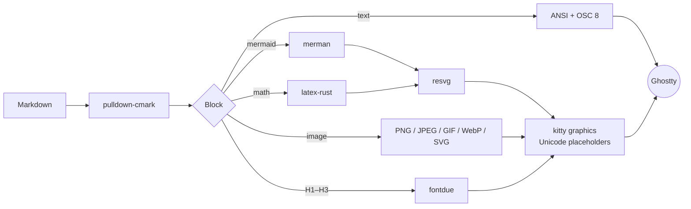

# martty

**Markdown, rendered properly, right in your terminal.**

A tiny, fast Markdown viewer built for [Ghostty](https://ghostty.org) (and Rex, which is
built on libghostty), with real images, Mermaid diagrams, big headings and a `less`-style
pager.

🌐 **Website: [turchenkoalex.github.io/martty](https://turchenkoalex.github.io/martty/)**,
a one-page tour: what the rendered output looks like, the pager keys and how to install.

[](https://turchenkoalex.github.io/martty/)


---

## Why martty?

Most terminal Markdown viewers have to stick to plain text. martty is built for one terminal
and uses everything it can do: kitty graphics with Unicode placeholders, OSC 8 hyperlinks,
synchronized output and theme color queries. Your README looks like a document, not a dump
of asterisks.

- 🖼️ **Images inline.** PNG, JPEG, GIF, WebP and SVG, drawn with the kitty graphics
  protocol; animated GIF and WebP play as kitty animations.
- 📊 **Mermaid diagrams.** Flowcharts, sequence diagrams, pie charts and more, rendered
  locally without a browser and colored to match your Ghostty theme.
- 🔠 **Big headings.** H1–H3 are drawn at large sizes in the bold face of your terminal's
  font (Ghostty's `font-family`, or the font chosen in Rex), or in the bundled JetBrains
  Mono when that font isn't installed.
- ∑ **Math.** LaTeX formulas, inline and display, typeset with TeX's rules in STIX Two
  Math.
- 🎨 **Theme-aware.** Highlighted code, diagrams and headings take their colors from your
  terminal's palette, so they suit both light and dark themes. When Ghostty switches
  between its light and dark theme, the pager redraws the document in the new colors.
- 📜 **Built-in pager.** Scrolling, highlighted search, a table of contents, zoomable and
  pannable diagrams, copying as plain text, following a file as you edit it, and live
  re-layout when the window is resized.
- 🪶 **Self-contained.** A single static binary: no browser, no Node, no runtime to install.

## Supported Markdown

| Element | Notes |
|---|---|
| Headings | H1–H3 drawn as large images, H4–H6 styled as text |
| Emphasis | **bold**, *italic*, ~~strikethrough~~, `inline code`, `==highlight==` |
| Links | Clickable through OSC 8 (relative paths become `file://` URLs); in the pager also by `Tab` and `Enter` |
| Lists | Nested, ordered (numbers aligned on the dot), and task lists `- [x]` |
| Block quotes | Drawn with a left bar, including images inside quotes |
| Alerts | GitHub `> [!NOTE]`, `[!TIP]`, `[!IMPORTANT]`, `[!WARNING]`, `[!CAUTION]` with a colored bar and title |
| Code blocks | Syntax highlighting in the terminal palette's colors, on a background derived from your theme |
| Tables | Column alignment (`:---:`, `---:`); a table wider than the screen shrinks its columns by content and wraps the text in its cells |
| Footnotes | `[^1]` style |
| Definition lists | `Term` followed by `: definition` lines |
| Images | PNG, JPEG, GIF, WebP and SVG, local or (with `--remote`) from https; animated GIF and WebP play; images of one paragraph (a row of badges) sit side by side as far as the width allows; a missing or unreadable image falls back to its alt text |
| Mermaid | ` ```mermaid ` blocks are rendered as diagrams, centered, with text at the terminal's size; click one to open it full screen |
| Math | `$…$` inline, sitting on the text baseline; `$$…$$` and ` ```math ` blocks centered on their own rows. A formula latex-rust can't render shows as code |
| Rules | `---` |
| Emoji | Common GitHub shortcodes such as `:rocket:` and `:+1:` |
| HTML | `<br>`, `<kbd>`, `<sub>`/`<sup>`, `<details>`/`<summary>` (expanded), `<b>`, `<i>`, `<mark>`, `<a>`, ``; other tags are dropped and their text kept, comments hidden |
| Front matter | YAML (`---`) or TOML (`+++`), shown as dimmed `key  value` lines |

## Installation

### Homebrew (macOS, Linux)

```sh
brew install turchenkoalex/tap/martty
```

### Prebuilt binaries

Each [release](https://github.com/turchenkoalex/martty/releases/latest) has binaries for
macOS on Apple silicon and for Linux on x86_64 and arm64:

| System | Archive |
|---|---|
| macOS, Apple silicon | [`martty-aarch64-apple-darwin.tar.gz`](https://github.com/turchenkoalex/martty/releases/latest/download/martty-aarch64-apple-darwin.tar.gz) |
| Linux, x86_64 | [`martty-x86_64-unknown-linux-musl.tar.gz`](https://github.com/turchenkoalex/martty/releases/latest/download/martty-x86_64-unknown-linux-musl.tar.gz) |
| Linux, arm64 | [`martty-aarch64-unknown-linux-musl.tar.gz`](https://github.com/turchenkoalex/martty/releases/latest/download/martty-aarch64-unknown-linux-musl.tar.gz) |

Each archive has a `.sha256` next to it. To install into `~/.local/bin`, put your
system's name in `target`:

```sh
target=aarch64-apple-darwin   # or x86_64-unknown-linux-musl, aarch64-unknown-linux-musl
mkdir -p ~/.local/bin
curl -fsSL https://github.com/turchenkoalex/martty/releases/latest/download/martty-$target.tar.gz \
  | tar -xz -C ~/.local/bin --strip-components 1 martty-$target/martty
```

The Linux binaries are static (musl), so they run on any distribution. The macOS binary is
signed ad hoc, not with an Apple Developer ID. `curl` doesn't mark the file as downloaded,
but one saved from a browser is quarantined and macOS refuses to run it; clear the flag
with `xattr -d com.apple.quarantine martty`. On an Intel Mac, build from source.

### From source

You need a recent stable Rust toolchain with edition 2024 support (Rust 1.100+) and a C
compiler (syntax highlighting builds the Oniguruma library).

```sh
git clone https://github.com/turchenkoalex/martty.git
cd martty
cargo install --path .
```

Or build without installing:

```sh
cargo build --release
./target/release/martty demo.md
```

What changed in each release is in [CHANGELOG.md](CHANGELOG.md), also on the
[site](https://turchenkoalex.github.io/martty/changelog.html).

## Usage

```sh
martty README.md            # view a file
cat notes.md | martty       # read from stdin
martty - < notes.md         # same, explicitly
martty -p short.md          # always open the pager
martty -P long.md | head    # never open the pager
martty --width 72 notes.md  # lay out for 72 columns
martty -w README.md         # reload whenever README.md is saved
martty https://github.com/owner/repo/blob/main/README.md  # download and view
martty --help               # options, environment and pager keys
```

Run with no file and nothing on stdin, martty prints the same help.

| Flag | Meaning |
|---|---|
| `-p`, `--pager` | Always open the pager |
| `-P`, `--no-pager` | Never open the pager; print straight to stdout |
| `--remote` | Load `https://` images (see [Remote images](#remote-images)) |
| `-w`, `--follow` | Open the pager and lay the file out again whenever it changes, keeping your place |
| `--width N` | Lay out text for `N` columns instead of the terminal width (80 when it is unknown, as in a pipe) |
| `-h`, `--help` | Show usage |
| `-V`, `--version` | Show the version |

By default martty prints the document directly. If the output is taller than the screen
and stdout is a terminal, it opens the pager. Relative image paths are resolved against the
Markdown file's directory, or against the current directory when reading stdin.

Instead of a file you can pass an `http://` or `https://` URL: martty downloads the
document (30 s timeout, at most 16 MB) and shows it. A GitHub file page
(`github.com/OWNER/REPO/blob/REF/PATH`) is read from `raw.githubusercontent.com`.
Relative links and images in it resolve against the URL, so links to other `.md` files
open in the pager too; its images still load only with `--remote`. `-w` works with files only.

Try the bundled demo to see everything at once:

```sh
cargo run --release -- demo.md
```

### Remote images

Images from `https://` URLs load only when you ask for them on each run with `--remote`
or `MARTTY_REMOTE=1`; otherwise they show their alt text, and viewing a document makes no
network requests. They are fetched in parallel before the document is shown (10 s
timeout) and cached for a day in `~/Library/Caches/martty` (macOS) or
`$XDG_CACHE_HOME/martty`; a stale copy is used when the network fails. A document is
untrusted input, so fetching is fenced in:

- `https` only, redirects included; `http://` images show their alt text.
- No requests into your network: names resolving to loopback, private, link-local or
  other non-public addresses are refused, checked after DNS.
- At most 32 images and 64 MB per run, 16 MB per image; a response that says it is bigger,
  or isn't an image (an HTML page), is dropped before its body is read.
- The User-Agent is just `martty`, without a version.
- A downloaded SVG may embed only `data:` images, never local files.
- The cache drops files older than a week and keeps at most 100 MB.

## Pager keys

The pager follows `less` conventions. `?` shows the keys in the pager.

| Keys | Action |
|---|---|
| `j` `e` `↓` `Enter` `Ctrl-N` | Scroll down one line (`Enter` opens the selected link) |
| `k` `↑` `Ctrl-P` | Scroll up one line |
| `Space` `f` `z` `PgDn` `Ctrl-F` | Page down |
| `b` `PgUp` `Ctrl-B` | Page up |
| `d` `Ctrl-D` / `u` `Ctrl-U` | Half page down / up |
| `g` `<` `Home` / `G` `>` `End` | Go to the top / bottom |
| `[` / `]` | Previous / next heading |
| `t` | Table of contents: `j`/`k` to move, `Enter` to go, `Esc` to close |
| `/` | Search (smart case: case-sensitive only if the query has uppercase letters). Matches are highlighted and the status line counts them, as in `3/17` |
| `n` / `N` | Next / previous match |
| `Esc` | Drop the link selection, then the search highlight |
| `h` `←` / `l` `→` | Pan wide images, diagrams, code and tables left / right (only `h` / `l` in a full-screen diagram) |
| `w` | Switch wide code blocks and tables between wrapped (the default) and their natural width, panned with `h`/`l` |
| `+` `=` / `-` `_` / `0` | Zoom images and diagrams in / out / reset |
| `Tab` / `Shift-Tab` | Select the next / previous link, scrolling to it |
| `Enter` | Open the selected link: `#heading` jumps to it, a relative `.md` file opens in the pager, and so does an `http(s)` link to a `.md` file (downloaded; a GitHub file page is read raw, and a failed download is reported on the status line); any other `http`, `https` or `mailto` link or another local file opens with `open` (`xdg-open` on Linux). Other schemes, programs, scripts and app bundles are not opened |
| `Backspace` `H` | Go back from an opened file or a full-screen diagram |
| `o` | Open the diagram on screen full screen |
| `o` `Space` `Esc` `q` | Close the full-screen diagram |
| `←` / `→` | In a full-screen diagram: open the previous / next diagram of the document; going back lands on the one shown last |
| `y` | Copy the code block on screen (or a diagram's Mermaid source) to the clipboard |
| `c` / `C` | Copy the screen / the whole document as plain text |
| `m` *letter* | Set a mark |
| `'` *letter* / `''` | Go to a mark / back to where the last jump started |
| `s` | Switch between the rendered document and its Markdown source, highlighted and with line numbers, keeping your place. Search, headings, the table of contents and copying work in both; `w` pans long source lines instead of wrapping them |
| `v` | Edit the file in `$VISUAL` or `$EDITOR` (`vi` when neither is set), then come back to the pager with your edits laid out. Vim, Neovim, Nano, Micro, Helix, Emacs, Zed, Sublime Text, VS Code and Cursor open at the section on screen |
| `F` | Follow changes to the file, as `-w` does |
| `?` | Show the keys |
| `q` `Ctrl-C` | Quit |
| Mouse wheel | Scroll |

Copying goes through OSC 52 and gives the text as written rather than as drawn: quote
bars, list markers and indents are left out, and code blocks, diagrams, images, formulas
and headings drawn as images are replaced with their source, alt text or heading text.

> [!TIP]
> The pager leaves the mouse to Ghostty: select text and Cmd+click links as usual.

## Configuration

At startup martty sends the terminal a single round of queries to detect its features:
theme colors, kitty graphics support, cell size in pixels and OSC 66 text sizing. If
detection gets something wrong, override it with environment variables. All of martty's
settings start with `MARTTY_`:

| Variable | Values | Effect |
|---|---|---|
| `MARTTY_IMAGES` | `0` / `1` | Disable or force images, diagrams and image headings |
| `MARTTY_REMOTE` | `1` | Load `https://` images, as `--remote` does |
| `MARTTY_TEXT_SIZING` | `0` / `1` | Disable or force OSC 66 text sizing for headings |
| `MARTTY_NO_COLOR` | `1` | No colors: text keeps bold, italic and underline; images, diagrams and image headings are off, as with `MARTTY_IMAGES=0` |

The pager's `v` key opens the file in `$VISUAL`, or `$EDITOR`, run through `sh` as git
does, so the variable may hold arguments, as in `EDITOR="zed --wait"`.

The pager names the tab after the file it shows (OSC 2), including a file opened from a
link, and hands the title back when it exits. It also asks Ghostty to report theme switches (DEC 2031) and reads keys with the
kitty keyboard protocol, so Esc and Alt combinations are never confused. Slow layouts,
such as documents with many diagrams, and downloads show Ghostty's progress indicator
(OSC 9;4), with the share downloaded when the server sends the file's size. In Rex they report through its Program Status Protocol (OSC 7501) instead: the
tab shows a spinner with what martty is doing, and an error martty exits with stays on the
tab until you look. With `-w` (or `F`), a change to the file marks the tab as done, so a
document something else is writing tells you when it has news.

When graphics are not available, martty falls back to plain styled text: diagrams and
formulas show up as code and images as their alt text.

## How it works



Images are sent once and then placed as Unicode placeholder characters, so every rendered
line is plain text. That keeps scrolling and panning in the pager cheap: it redraws a window
of lines and never re-sends pixels.

Laying a document out only measures its images, diagrams and image headings. The pager
draws and sends them when they come within a screen of the visible part, several at once
on all CPU cores, so a long document with dozens of diagrams opens as fast as a short one.
What was drawn is kept for the session: zooming, resizing the window or saving a followed
file draws again only what changed.

| Module | Responsibility |
|---|---|
| `render/` | Markdown → lines of styled text |
| `term.rs` | Capability probing, raw mode, terminal size |
| `kitty.rs`, `diacritics.rs` | kitty graphics transmission and Unicode placeholders |
| `cache.rs` | Images, diagrams and headings drawn this session |
| `mermaid.rs` | Diagram rendering with theme colors |
| `math.rs` | LaTeX formulas rasterized at the terminal's text size |
| `heading.rs` | Large headings rasterized with fontdue |
| `pager/` | The `less`-like pager |
| `style.rs` | Colors and text attributes |

## Limitations

- **Ghostty and Rex only, by design.** Rex is built on libghostty and gets every feature.
  Other terminals with kitty graphics may work, but they are not a goal.
- Remote images are fetched before the document is shown, so a slow server delays the
  start (up to the 10 s timeout).
- Headings drawn as images can't be copied as text by selecting them with the mouse (`c`
  and `C` copy them). They will switch back to text once Ghostty implements OSC 66.
- Formulas are images too: they can't be copied as text.

## Development

```sh
cargo build
cargo test
cargo clippy
cargo fmt
```

## Acknowledgements

- [Ghostty](https://ghostty.org), the terminal this is built for
- [pulldown-cmark](https://github.com/pulldown-cmark/pulldown-cmark) for Markdown parsing
- [merman](https://github.com/Latias94/merman) and
  [resvg](https://github.com/linebender/resvg) for diagrams
- [fontdue](https://github.com/mooman219/fontdue) for glyph rasterization
- [syntect](https://github.com/trishume/syntect) for syntax highlighting
- [latex-rust](https://github.com/jscarr64/latex-rust) for typesetting math, with the
  [STIX Two Math](https://github.com/stipub/stixfonts) font it bundles under the SIL Open
  Font License
- [JetBrains Mono](https://www.jetbrains.com/lp/mono/), bundled under the
  [SIL Open Font License](assets/fonts/OFL.txt)

## License

martty is licensed under the [Apache License 2.0](LICENSE). The bundled JetBrains Mono font
is licensed separately under the [SIL Open Font License 1.1](assets/fonts/OFL.txt), as is
STIX Two Math, which latex-rust embeds.
