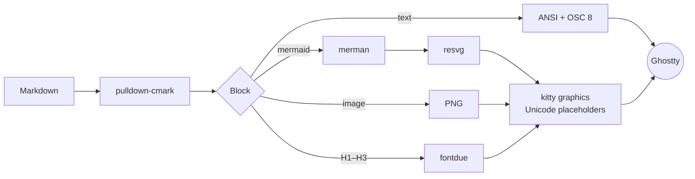

# martty

**Markdown, rendered properly, right in your terminal.**

A tiny, fast Markdown viewer built for [Ghostty](https://ghostty.org), with real images,
Mermaid diagrams, big headings and a `less`-style pager.


---

## Why martty?

Most terminal Markdown viewers have to stick to plain text. martty is built for one terminal
and uses everything it can do: kitty graphics with Unicode placeholders, OSC 8 hyperlinks,
synchronized output and theme color queries. Your README looks like a document, not a dump
of asterisks.

- 🖼️ **Images inline.** PNG files are drawn with the kitty graphics protocol.
- 📊 **Mermaid diagrams.** Flowcharts, sequence diagrams, pie charts and more, rendered
  locally without a browser and colored to match your Ghostty theme.
- 🔠 **Big headings.** H1–H3 are drawn at large sizes with JetBrains Mono.
- 🎨 **Theme-aware.** Highlighted code, diagrams and headings take their colors from your
  terminal's palette, so they suit both light and dark themes.
- 📜 **Built-in pager.** Scrolling, search, mouse wheel, zoomable and pannable diagrams,
  and live re-layout when the window is resized.
- 🪶 **Self-contained.** A single static binary: no browser, no Node, no runtime to install.

## Supported Markdown

| Element | Notes |
|---|---|
| Headings | H1–H3 drawn as large images, H4–H6 styled as text |
| Emphasis | **bold**, *italic*, ~~strikethrough~~, `inline code`, `==highlight==` |
| Links | Clickable through OSC 8 |
| Lists | Nested, ordered (numbers aligned on the dot), and task lists `- [x]` |
| Block quotes | Drawn with a left bar, including images inside quotes |
| Alerts | GitHub `> [!NOTE]`, `[!TIP]`, `[!IMPORTANT]`, `[!WARNING]`, `[!CAUTION]` with a colored bar and title |
| Code blocks | Syntax highlighting in the terminal palette's colors, on a background derived from your theme |
| Tables | Column alignment (`:---:`, `---:`) |
| Footnotes | `[^1]` style |
| Definition lists | `Term` followed by `: definition` lines |
| Images | Local PNG; a missing image falls back to its alt text |
| Mermaid | ` ```mermaid ` blocks are rendered as diagrams, centered, with text at the terminal's size; click one to open it full screen |
| Rules | `---` |
| Emoji | Common GitHub shortcodes such as `:rocket:` and `:+1:` |
| HTML | `<br>`, `<kbd>`, `<sub>`/`<sup>`, `<details>`/`<summary>` (expanded), `<b>`, `<i>`, `<mark>`, `<a>`, ``; other tags are dropped and their text kept, comments hidden |
| Front matter | YAML (`---`) or TOML (`+++`), shown as dimmed `key  value` lines |

## Installation

martty is not published yet, so build it from source. You need a recent stable Rust
toolchain with edition 2024 support (Rust 1.100+).

```sh
git clone <repo-url> martty
cd martty
cargo install --path .
```

Or build without installing:

```sh
cargo build --release
./target/release/martty demo.md
```

Two optional features are on by default:

| Feature | Adds | Without it |
|---|---|---|
| `mermaid` | Mermaid diagrams via merman, about 10 MB | ` ```mermaid ` blocks show as code |
| `highlight` | Syntax highlighting via syntect, about 1 MB; builds the Oniguruma C library, so it needs a C compiler | Code blocks in one color |

To leave both out, or pick one back:

```sh
cargo install --path . --no-default-features
cargo install --path . --no-default-features --features highlight
```

## Usage

```sh
martty README.md            # view a file
cat notes.md | martty       # read from stdin
martty - < notes.md         # same, explicitly
martty -p short.md          # always open the pager
martty -P long.md | head    # never open the pager
martty --width 72 notes.md  # lay out for 72 columns
```

```
usage: martty [-p|--pager] [-P|--no-pager] [--width N] [FILE]
```

| Flag | Meaning |
|---|---|
| `-p`, `--pager` | Always open the pager |
| `-P`, `--no-pager` | Never open the pager; print straight to stdout |
| `--width N` | Lay out text for `N` columns instead of the terminal width (80 when it is unknown, as in a pipe) |
| `-h`, `--help` | Show usage |

By default martty prints the document directly. If the output is taller than the screen
and stdout is a terminal, it opens the pager. Relative image paths are resolved against the
Markdown file's directory, or against the current directory when reading stdin.

Try the bundled demo to see everything at once:

```sh
cargo run --release -- demo.md
```

## Pager keys

The pager follows `less` conventions.

| Keys | Action |
|---|---|
| `j` `e` `↓` `Enter` `Ctrl-N` | Scroll down one line |
| `k` `y` `↑` `Ctrl-P` | Scroll up one line |
| `Space` `f` `PgDn` `Ctrl-F` | Page down |
| `b` `PgUp` `Ctrl-B` | Page up |
| `d` `Ctrl-D` / `u` `Ctrl-U` | Half page down / up |
| `g` `<` `Home` / `G` `>` `End` | Go to the top / bottom |
| `/` | Search (smart case: case-sensitive only if the query has uppercase letters) |
| `n` / `N` | Next / previous match |
| `h` `←` / `l` `→` | Pan wide images and diagrams left / right |
| `+` `=` / `-` `_` / `0` | Zoom diagrams in / out / reset |
| `z` or click | Open the diagram on screen full screen |
| `Esc` `q` | Close the full-screen diagram |
| `q` `Ctrl-C` | Quit |
| Mouse wheel | Scroll (horizontal wheel pans) |

> [!TIP]
> The pager captures the mouse, so to select text hold **Shift** while dragging.

## Configuration

At startup martty sends the terminal a single round of queries to detect its features:
theme colors, kitty graphics support, cell size in pixels and OSC 66 text sizing. If
detection gets something wrong, override it with environment variables:

| Variable | Values | Effect |
|---|---|---|
| `MARTTY_IMAGES` | `0` / `1` | Disable or force images, diagrams and image headings |
| `MARTTY_TEXT_SIZING` | `0` / `1` | Disable or force OSC 66 text sizing for headings |
| `NO_COLOR` | any non-empty | No colors: text keeps bold, italic and underline; images, diagrams and image headings are off, as with `MARTTY_IMAGES=0` |

When graphics are not available, martty falls back to plain styled text: diagrams show up
as code blocks and images as their alt text.

## How it works



Images are sent once and then placed as Unicode placeholder characters, so every rendered
line is plain text. That keeps scrolling and panning in the pager cheap: it redraws a window
of lines and never re-sends pixels.

| Module | Responsibility |
|---|---|
| `render/` | Markdown → lines of styled text |
| `term.rs` | Capability probing, raw mode, terminal size |
| `kitty.rs`, `diacritics.rs` | kitty graphics transmission and Unicode placeholders |
| `mermaid.rs` | Diagram rendering with theme colors |
| `heading.rs` | Large headings rasterized with fontdue |
| `pager/` | The `less`-like pager |
| `style.rs` | Colors and text attributes |

## Limitations

- **Ghostty only, by design.** Other terminals with kitty graphics may work, but they are
  not a goal.
- Only **PNG** images for now; JPEG, GIF, WebP and SVG are on the roadmap.
- Headings drawn as images can't be copied as text. They will switch back to text once
  Ghostty implements OSC 66.
- Wide tables don't wrap yet.

## Development

```sh
cargo build
cargo test
cargo clippy
cargo fmt
```

See [ROADMAP.md](ROADMAP.md) for planned work, in Russian: more image formats, link navigation, table of contents, watch mode and more.

## Acknowledgements

- [Ghostty](https://ghostty.org), the terminal this is built for
- [pulldown-cmark](https://github.com/pulldown-cmark/pulldown-cmark) for Markdown parsing
- [merman](https://github.com/Latias94/merman) and
  [resvg](https://github.com/linebender/resvg) for diagrams
- [fontdue](https://github.com/mooman219/fontdue) for glyph rasterization
- [syntect](https://github.com/trishume/syntect) for syntax highlighting
- [JetBrains Mono](https://www.jetbrains.com/lp/mono/), bundled under the
  [SIL Open Font License](assets/fonts/OFL.txt)

## License

martty is licensed under the [Apache License 2.0](LICENSE). The bundled JetBrains Mono font
is licensed separately under the [SIL Open Font License 1.1](assets/fonts/OFL.txt).
