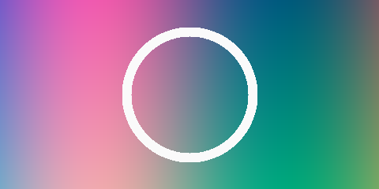
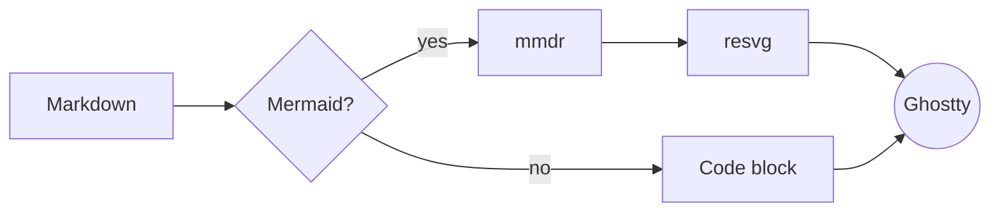
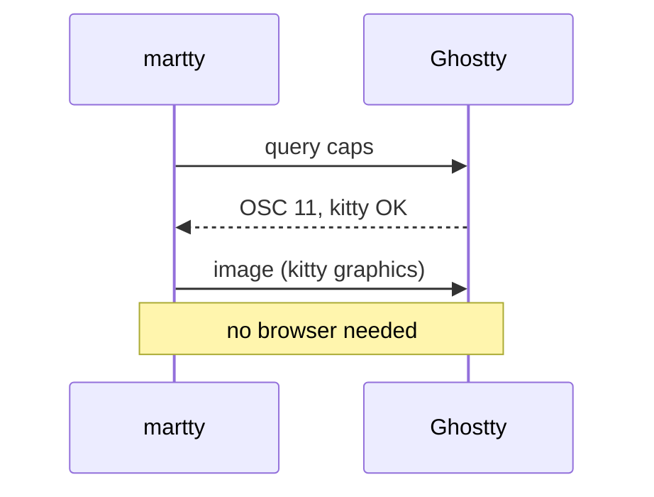
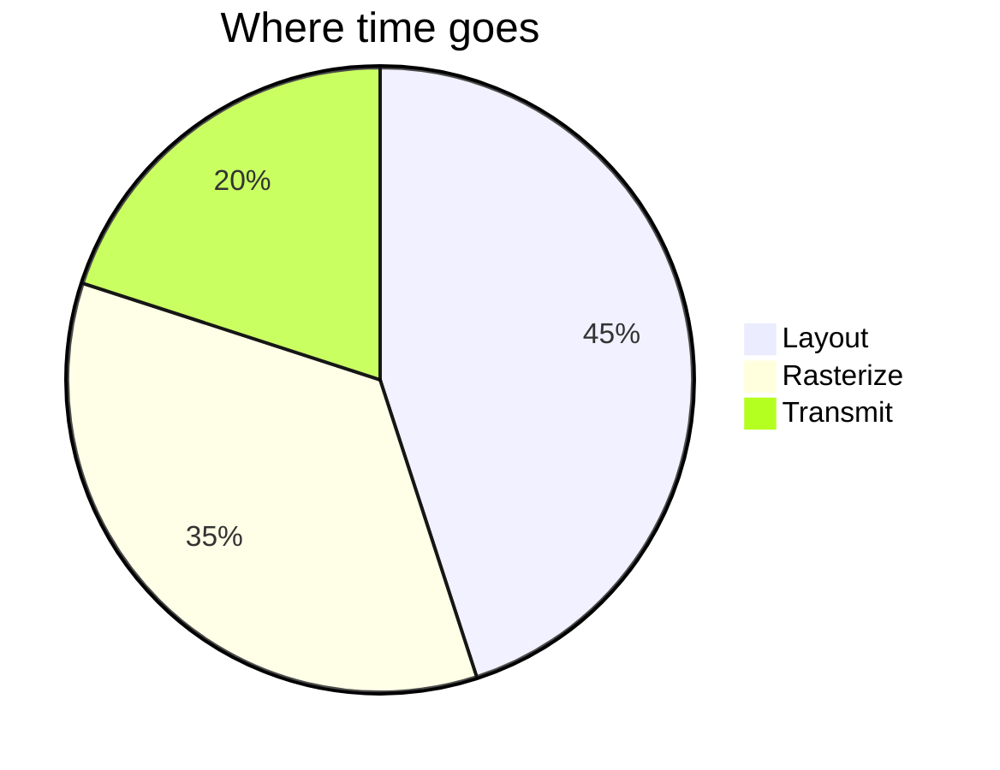

# martty

A tiny **Markdown** renderer for *Ghostty*, with `inline code`,
~~strikethrough~~ and [links](https://ghostty.org) that are clickable (OSC 8).

## Images



> Images in quotes keep the bar:
>
> 


## Diagrams







## Lists

- first item with a fairly long line of text that should wrap nicely under the bullet instead of under the margin
- second item
  - nested **bold** item
  - another one
- [ ] todo
- [x] done

1. one
2. two
3. three

### Code

```rust
fn main() {
    println!("hello, ghostty");
}
```

> Block quotes get a bar on the left.
>
> Even across *paragraphs*.

| Name   | Kind     | Size |
|--------|:--------:|-----:|
| martty  | binary   |  1 MB |
| ghostty | terminal | 30 MB |

---

#### Footnotes

Some claim[^1].

[^1]: The footnote.
