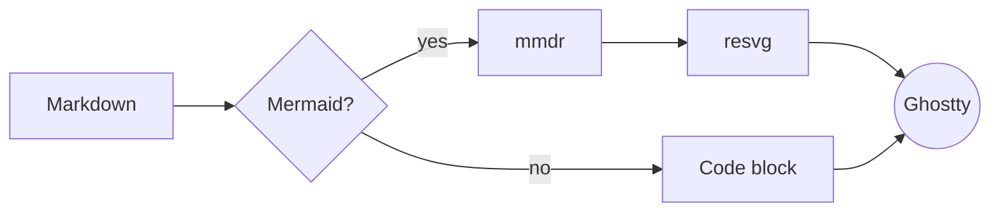
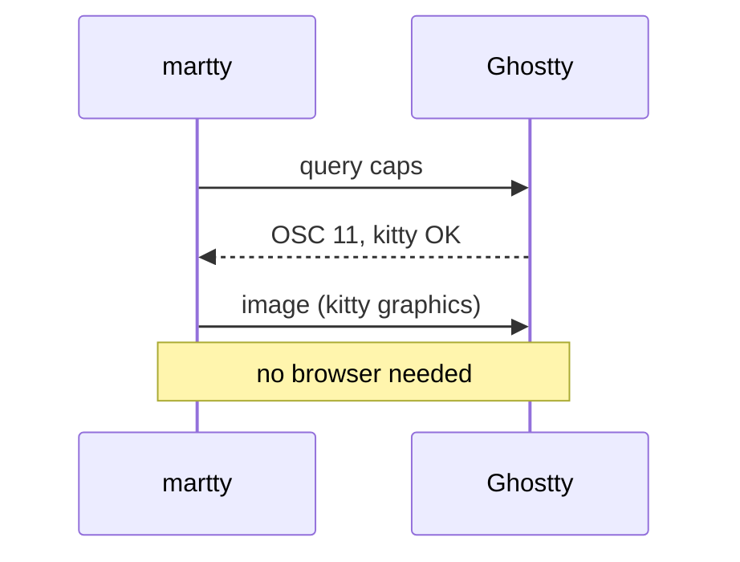
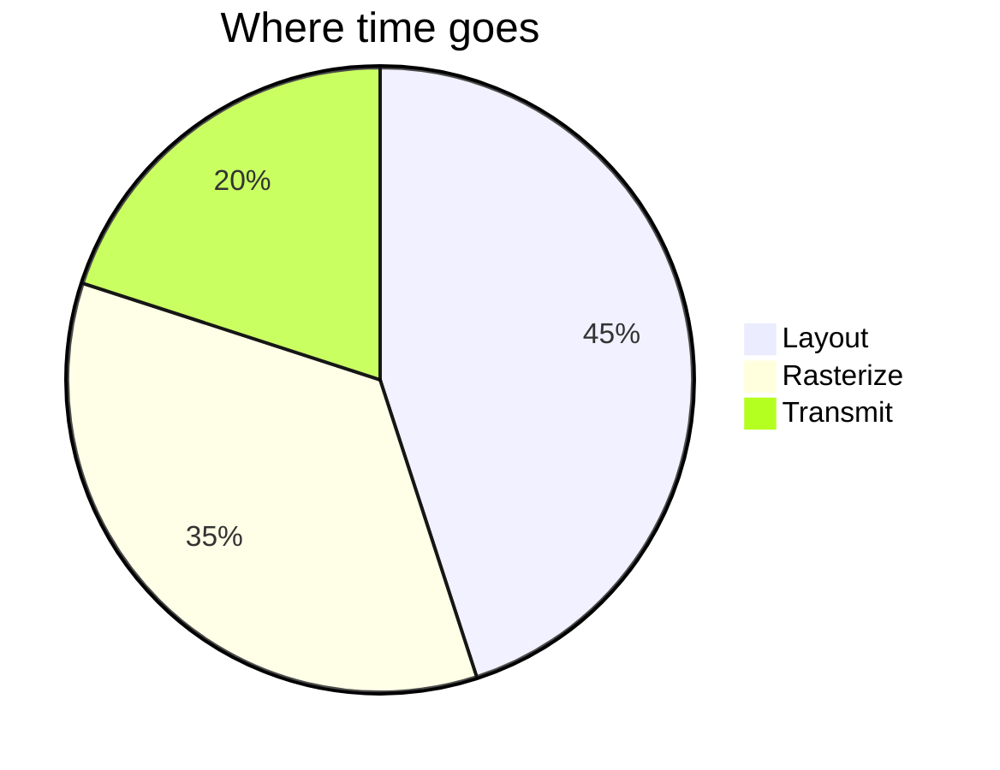

# martty

A tiny **Markdown** renderer for *Ghostty*, with `inline code`,
~~strikethrough~~ and [links](https://ghostty.org) that are clickable (OSC 8).

## Images


> Images in quotes keep the bar:
>
> 


## Diagrams







## Lists

- first item with a fairly long line of text that should wrap nicely under the bullet instead of under the margin
- second item
  - nested **bold** item
  - another one
- [ ] todo
- [x] done

8. eight
9. nine
10. ten, numbers line up on the dot

### Code

```rust
fn main() {
    println!("hello, ghostty");
}
```

> Block quotes get a bar on the left.
>
> Even across *paragraphs*.

> [!NOTE]
> GitHub alerts get a colored bar and a title.

> [!WARNING]
> Five kinds: note, tip, important, warning and caution.

| Name   | Kind     | Size |
|--------|:--------:|-----:|
| martty  | binary   |  1 MB |
| ghostty | terminal | 30 MB |

---

#### Definitions

martty
: A Markdown viewer for Ghostty, with ==highlighted text== too.

Ghostty
: A fast, native terminal emulator.

#### HTML

Press <kbd>Ctrl</kbd>+<kbd>C</kbd> to quit. Water is H<sub>2</sub>O, area is r<sup>2</sup>,<br>
and <mark>this</mark> is highlighted. <!-- comments are hidden -->

<details>
<summary>Details are shown expanded</summary>

With the summary as a title.

</details>

#### Footnotes

Some claim[^1].

[^1]: The footnote.
