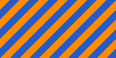
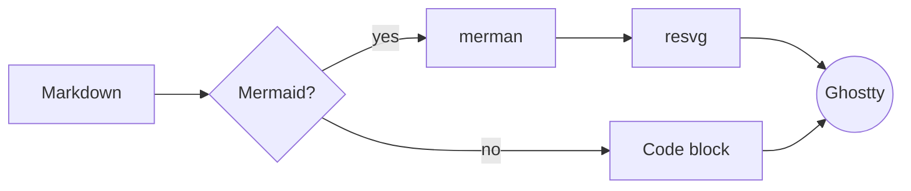
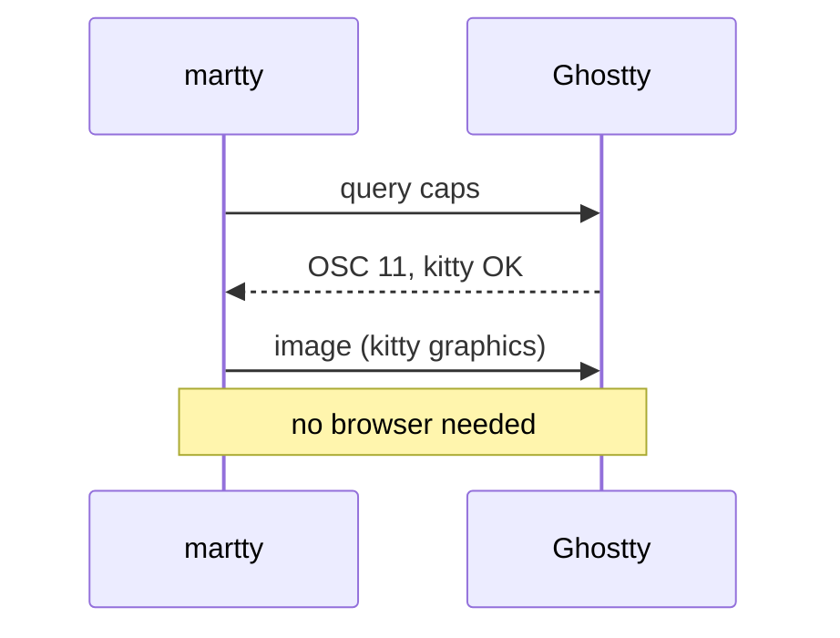
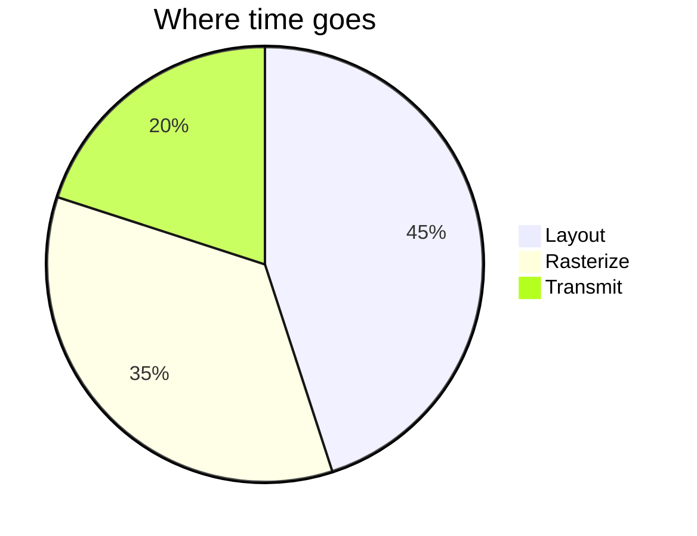

# martty

A tiny **Markdown** renderer for *Ghostty*, with `inline code`,
~~strikethrough~~ and [links](https://ghostty.org) that are clickable (OSC 8).
This page exercises everything martty renders today and everything on the
[roadmap](ROADMAP.md), so it shows what already works and what doesn't yet.

## Text

**Bold**, *italic*, ***bold italic***, ~~strikethrough~~, ~single tilde~,
`code with **no** markup`, ==highlighted text== and a == b left alone.

Autolinks: <https://ghostty.org>, https://github.com/ghostty-org/ghostty and
<mailto:hello@example.com>. A [link with a title](https://ghostty.org "Ghostty") and a
[reference link][ghostty].

Escapes: \*not italic\*, \`not code\`, \# not a heading, 1\. not a list.

Smart punctuation: "double quotes", 'single quotes', en -- dash, em --- dash, ellipsis...

Hard breaks: this line ends with two spaces  
and this one with a backslash\
and this is the third line.

Emoji shortcodes: :rocket: :tada: :+1: :sparkles: :warning: :bug: :crab:,
while an unknown :not_an_emoji: and a time 10:30:00 stay as they are.

A very long word that must be split: Donaudampfschifffahrtselektrizitätenhauptbetriebswerkbauunterbeamtengesellschaft.
A long URL: https://example.com/a/very/long/path/that/does/not/fit/on/one/line/at/all/in/a/narrow/terminal/window.html

Wide characters: 日本語のテキスト, 한국어, emoji 👩‍💻 ❤️ in running text.

Math, inline: $E = mc^2$, $\alpha_i + \beta^2$ and $\sum_{i=1}^{n} i = \frac{n(n+1)}{2}$, which wrap
with the text around them. Prices are not math: $5 and $10.

$$
\int_0^1 x^2 \, dx = \frac{1}{3}
$$

```math
f(x) = \begin{cases} x^2 & x \ge 0 \\ -x & \text{otherwise} \end{cases}
```

A formula martty can't typeset stays as code: $\notacommand{x}$.

[ghostty]: https://ghostty.org

## Headings

Setext heading level 1
======================

Setext heading level 2
----------------------

### Heading 3 with `code` and *emphasis*

#### Heading 4

##### Heading 5

###### Heading 6

### A long heading that has to wrap onto a second line in a narrow terminal window

### Heading with emoji 🚀

## Lists

- first item with a fairly long line of text that should wrap nicely under the bullet instead of under the margin
- second item
  - nested **bold** item
  - another one
    - third level
      - fourth level
- [ ] todo
- [x] done :tada:
  - [ ] nested todo
- shortcodes like :rocket: and :+1: become emoji

8. eight
9. nine
10. ten, numbers line up on the dot

1. ordered
   - with a bullet inside
   - and another
2. second, with a paragraph:

   A loose item has blank lines between its paragraphs.

3. third
   ```sh
   echo "code inside a list item"
   ```

## Quotes and alerts

> Block quotes get a bar on the left.
>
> Even across *paragraphs*.
>
> > And nested quotes get a second bar.
>
> - lists inside quotes
> - keep the bar
>
> ```rust
> let code = "inside a quote";
> ```

> [!NOTE]
> GitHub alerts get a colored bar and a title.

> [!TIP]
> Five kinds: note, tip, important, warning and caution.

> [!IMPORTANT]
> Alerts can hold **formatting**, `code` and
>
> several paragraphs.

> [!WARNING]
> A warning.

> [!CAUTION]
> And a caution.

## Code

Syntax highlighting, with colors from the terminal palette:

```rust
use std::collections::HashMap;

/// Counts words, case-insensitively.
fn count(text: &str) -> HashMap<String, usize> {
    let mut counts = HashMap::new();
    for word in text.split_whitespace() {
        *counts.entry(word.to_lowercase()).or_insert(0) += 1;
    }
    counts // r"raw string", 'c', 0x1F, 1_000u64
}
```

```python
from dataclasses import dataclass

@dataclass
class Point:
    x: float
    y: float

    def norm(self) -> float:
        """Euclidean length."""
        return (self.x ** 2 + self.y ** 2) ** 0.5  # comment
```

```go
package main

import "fmt"

func main() {
	for i := 0; i < 3; i++ {
		fmt.Printf("tab-indented %d\n", i)
	}
}
```

```typescript
interface User { id: number; name: string }

const greet = async (user: User): Promise<string> =>
  `hello, ${user.name}!`;
```

```bash
#!/usr/bin/env bash
set -euo pipefail
for f in *.md; do
  echo "rendering $f" && martty -P "$f" > "${f%.md}.txt"
done
```

```json
{ "name": "martty", "version": "0.1.0", "features": ["mermaid", null, true, 42] }
```

```yaml
# CI matrix
jobs:
  test:
    runs-on: [macos-latest, ubuntu-latest]
    steps: { run: "cargo test" }
```

```toml
[package]
name = "martty"
edition = "2024"
```

```sql
SELECT name, count(*) AS n FROM files WHERE ext = 'md' GROUP BY name;
```

```diff
- removed line
+ added line
  unchanged line
```

```
A code block without a language.
```

    An indented code block.

```text
A very long line that does not fit on the screen and has to be wrapped or scrolled horizontally: 0123456789 0123456789 0123456789
```

## Tables

| Name   | Kind     | Size |
|--------|:--------:|-----:|
| martty  | binary   |  1 MB |
| ghostty | terminal | 30 MB |

| Formatting | Example |
|---|---|
| **bold** and *italic* | `code` and [link](https://ghostty.org) |
| emoji :rocket: | wide 日本語 |
| empty → | |

A table wider than the screen, whose cells should wrap:

| Feature | Status | Description | Notes |
|---|---|---|---|
| Syntax highlighting | done | Colors for keywords, strings, comments and numbers in fenced code blocks, taken from the terminal palette. | syntect with Oniguruma, behind the `highlight` feature. |
| Table wrapping | done | Cells wrap when the table is wider than the screen, with columns sized by their content. | This very table is the test case. |
| Math | done | Inline `$…$` and display `$$…$$` formulas. | latex-rust, behind the `math` feature. |

## Images

PNG, alone in a paragraph:


> Images in quotes keep the bar:
>
> 


An image  in the middle of text shows its alt text.

JPEG:


GIF:


Animated GIF:


WebP:



SVG:


Remote PNG and SVG:


HTML image:

<p align="center"></p>

## Diagrams







```mermaid
this is not valid mermaid
```

## HTML

Press <kbd>Ctrl</kbd>+<kbd>C</kbd> to quit. Water is H<sub>2</sub>O, area is r<sup>2</sup>,<br>
and <mark>this</mark> is highlighted. <!-- comments are hidden -->
Inline <b>bold</b>, <i>italic</i>, <s>struck</s>, <u>underlined</u>, <code>code</code> and
an <a href="https://ghostty.org">HTML link</a>. Entities: &amp; &lt; &gt; &copy; &#x2713;.

<details>
<summary>Details are shown expanded</summary>

With the summary as a title.

</details>

<div align="center">
  <b>Centered</b> blocks keep their text.
</div>

<!--
A multi-line comment
is hidden too.
-->

## Definitions

martty
: A Markdown viewer for Ghostty, with ==highlighted text== too.

Ghostty
: A fast, native terminal emulator.
: Second definition of the same term.

## Links

Links to move between with `Tab` and open with `Enter`:

- a relative Markdown file opens inside martty: [README](README.md), [ROADMAP](ROADMAP.md)
- a heading on this page: [Tables](#tables)
- a web page opens in the browser: [Ghostty](https://ghostty.org)
- a local file: [license](LICENSE)

---

## Footnotes

Some claim[^1], and another one[^long].

[^1]: The footnote.

[^long]: A footnote with several paragraphs.

    The second paragraph of the footnote.
